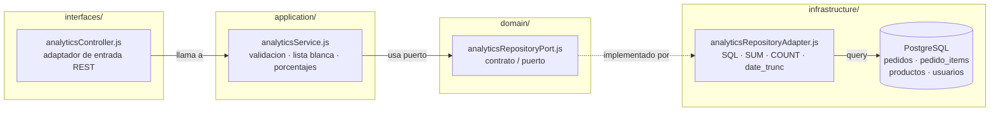

# Diagrama Arquitectónico — Arquitectura Hexagonal

El proyecto sigue el patrón **Hexagonal (Ports & Adapters)** 

---

## Diagrama de capas

```
                    ┌─────────────────────────────────────────────┐
                    │             INTERFACES                      │
                    │       (Adaptadores de entrada)              │
                    │                                             │
                    │  authMiddleware    soloRol                  │
                    │  userController    productController        │
                    │  orderController   captchaController        │
                    │                                             │
                    │  Express HTTP → recibe requests             │
                    └───────────────┬─────────────────────────────┘
                                    │  llaman a
                                    ▼
                    ┌─────────────────────────────────────────────┐
                    │            APPLICATION                      │
                    │        (Casos de uso / Servicios)           │
                    │                                             │
                    │  userService     productService             │
                    │  orderService    captchaStore               │
                    │                                             │
                    │  Orquestan el dominio + puertos             │
                    └───────────────┬─────────────────────────────┘
                                    │  usan entidades
                                    ▼
                    ┌─────────────────────────────────────────────┐
                    │              DOMAIN                         │
                    │      (Entidades + Puertos + Reglas)         │
                    │                                             │
                    │  User    Product    Order                   │
                    │                                             │
                    │  Puertos (interfaces):                      │
                    │  UserRepositoryPort  ProductRepositoryPort  │
                    │  OrderRepositoryPort NotificationPort       │
                    │                                             │
                    │  ⚠ No conoce nada externo                   │
                    │  (ni pg, ni express, ni bcrypt)             │
                    └───────────────▲─────────────────────────────┘
                                    │  implementan los puertos
                                    │
                    ┌───────────────┴─────────────────────────────┐
                    │          INFRASTRUCTURE                     │
                    │       (Adaptadores de salida)               │
                    │                                             │
                    │  db.js                     ← pool pg        │
                    │  userRepositoryAdapter                      │
                    │  productRepositoryAdapter                   │
                    │  orderRepositoryAdapter                     │
                    │  emailNotificationAdapter  ← nodemailer     │
                    │  captchaAdapter            ← svg-captcha    │
                    │  captchaStore              ← memoria        │
                    │  uploadAdapter             ← multer         │
                    │                                             │
                    │  bcrypt  →  usado directo en userService    │
                    └─────────────────────────────────────────────┘
```

---

## Estructura de carpetas del backend

```
backend/src/
├── server.js                            # Punto de entrada
├── .env                                 # Variables de entorno
│
├── domain/                              # Lógica
│   ├── user.js                          # Entidad Usuario
│   ├── product.js                       # Entidad Producto
│   ├── order.js                         # Entidad Pedido
│   ├── userRepositoryPort.js            # Contrato de persistencia
│   ├── productRepositoryPort.js         # Contrato de persistencia
│   ├── orderRepositoryPort.js           # Contrato de persistencia
│   └── notificationPort.js              # Contrato de notificaciones
│
├── application/                         # Casos de uso
│   ├── userService.js
│   ├── productService.js
│   └── orderService.js
│
├── infrastructure/                      # Adaptadores
│   ├── db.js                            # Pool de PostgreSQL
│   ├── userRepositoryAdapter.js
│   ├── productRepositoryAdapter.js
│   ├── orderRepositoryAdapter.js
│   ├── emailNotificationAdapter.js      # Nodemailer
│   ├── captchaAdapter.js                # Genera el SVG
│   ├── captchaStore.js                  # Guarda texto por ID
│   └── uploadAdapter.js                 # Configura multer
│
└── interfaces/                          # Entrada HTTP
    ├── authMiddleware.js                # Verifica JWT
    ├── roleMiddleware.js                # Verifica rol
    ├── userController.js
    ├── productController.js
    ├── orderController.js
    └── captchaController.js
```

---

## Reglas de la arquitectura

| Capa | Puede importar | NO puede importar |
|---|---|---|
| **domain** | Otros archivos de `domain/` | Nada externo |
| **application** | `domain/` | `infrastructure/`, `interfaces/`, Express, pg |
| **infrastructure** | `domain/` (implementa puertos) | `application/`, `interfaces/` |
| **interfaces** | `application/` | `infrastructure/` directamente |

---

## Verificación

Para confirmar que la regla se cumple:

```bash
# El dominio NO debe tener imports de librerías externas
grep -rn "require('pg')\|require('express')\|require('bcrypt')" backend/src/domain/
# (debe salir vacío)
```

---

## Flujo de una petición HTTP

Ejemplo: `POST /productos` con rol `producto`

```
1. Cliente envía POST /productos con imagen y JWT
        ↓
2. Express → authMiddleware (verifica JWT)
        ↓
3. authMiddleware → roleMiddleware('producto')  (verifica rol)
        ↓
4. uploadAdapter (multer) procesa la imagen
        ↓
5. productController.crear(req, res)  ← INTERFACES
        ↓
6. productService.registrarProducto({...})  ← APPLICATION
        ↓
7. new Product({...}).validar()  ← DOMAIN
        ↓
8. productRepository.create(product)  ← APPLICATION llama al puerto
        ↓
9. productRepositoryAdapter.create(product)  ← INFRASTRUCTURE
        ↓
10. INSERT INTO productos ...  ← PostgreSQL
        ↓
11. Respuesta 201 con el producto creado
```

---

## Subsistema Analítico

El módulo analítico es un **puerto de consultas independiente** que extrae métricas agregadas sin sobrecargar las entidades operativas (Usuario, Producto, Pedido).

### Principio de diseño

- **Desacoplamiento total**: `AnalyticsRepositoryPort` no extiende ningún puerto operativo.
- **Sin entidades de dominio operativas**: devuelve DTOs planos, no instancias de `User`, `Product` u `Order`.
- **Todo el cómputo en PostgreSQL**: SUM, COUNT, AVG, GROUP BY, date_trunc. Cero filas individuales en Node.
- **Seguridad SQL**: `date_trunc` se valida con lista blanca en `analyticsService.js` antes de interpolarse.

---

### Diagrama de flujo (Mermaid)



---

### Independencia respecto a entidades operativas

```
analyticsService.js        NO importa User, Product, Order
analyticsController.js     NO importa orderService, productService, userService
analyticsRepositoryPort.js contrato nuevo e independiente
```

---

### Nuevos archivos y extensiones del subsistema analítico

| Capa | Archivo | Rol |
|---|---|---|
| domain | `analyticsRepositoryPort.js` | Contrato con parámetros de alcance (`productorId`, `usuarioId`) y método `stockBajo` |
| application | `analyticsService.js` | Casos de uso reutilizados con alcance de usuario, cálculo de porcentajes y stock bajo |
| infrastructure | `analyticsRepositoryAdapter.js` | Consultas SQL optimizadas en BD parametrizadas (`$1, $2...`) filtrando por `pr.creado_por` o `p.usuario_id` |
| interfaces | `analyticsController.js` | Endpoints admin (`/reportes/*`), vendedor (`/reportes/mis-ventas/*`) y comprador (`/reportes/mis-compras/*`), tomando siempre `req.user.id` del token |

### Endpoints por Rol

| Rol | Rutas backend | Descripción |
|---|---|---|
| `admin` | `GET /reportes/{resumen, ingresos, estados, top-productos, ticket-promedio}` | Métricas globales de la plataforma |
| `producto` | `GET /reportes/mis-ventas/{resumen, ingresos, top, stock-bajo, estados}` | Métricas de los vinilos del vendedor (`pr.creado_por = req.user.id`) |
| `pedido` | `GET /reportes/mis-compras/{resumen, gasto, estados, top}` | Métricas de compras del usuario (`p.usuario_id = req.user.id`) |

### Índices analíticos en base de datos

```sql
CREATE INDEX IF NOT EXISTS idx_pedidos_created_at         ON pedidos(created_at);
CREATE INDEX IF NOT EXISTS idx_pedidos_estado_created_at  ON pedidos(estado, created_at);
CREATE INDEX IF NOT EXISTS idx_pedido_items_producto_id   ON pedido_items(producto_id);
CREATE INDEX IF NOT EXISTS idx_productos_creado_por       ON productos(creado_por);
CREATE INDEX IF NOT EXISTS idx_pedidos_usuario            ON pedidos(usuario_id);
```

### Mapeo de estados analíticos

| Estado real (BD) | Categoría analítica |
|---|---|
| pendiente_pago | Pendiente |
| verificando_pago | Pendiente |
| aprobado | Pagado |
| rechazado | Cancelado |

`ESTADOS_VENTA = ['aprobado']` — solo estos pedidos cuentan como ingreso/gasto real.

### Componentes frontend

| Archivo | Descripción |
|---|---|
| `paginas/admin/AdminReportes.jsx` | Dashboard analítico para administradores |
| `components/reportes/ProductoReportes.jsx` | Dashboard de ventas para rol producto (KPIs, ingresos, estados, top vinilos, stock bajo) |
| `components/reportes/PedidoReportes.jsx` | Dashboard de compras para rol pedido (KPIs, gasto, estados, top vinilos comprados) |
| `components/reportes/FiltroFechas.jsx` | Presets + rango personalizado + selectores |
| `components/reportes/GraficoIngresos.jsx` | ComposedChart barras+línea configurable (Ingresos o Gasto) |
| `components/reportes/GraficoEstados.jsx` | PieChart con colores semánticos TalkVinyl |
| `components/reportes/TablaTopProductos.jsx` | Ranking con medallas y barras de progreso |
